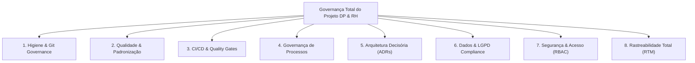

# Manual Integrado de Governança de Tecnologia da Informação (TI) & Software

**Projeto:** Portal DP & RH — Sistema de Departamento Pessoal & Recursos Humanos  
**Autoria:** Equipe Interdisciplinar dos Cursos de Recursos Humanos (RH) e Gestão da Tecnologia da Informação (GTI)  
**Destinatário:** Corpo Docente, Professores Orientadores e Avaliadores Acadêmicos  
**Versão:** 2.0 — Governança Total  
**Data:** 28 de Outubro de 2026  

---

## 1. Visão Executiva e Propósito da Governança

A governança corporativa de TI em sistemas de Departamento Pessoal e Recursos Humanos é um elemento crítico de sustentabilidade organizacional. Por manipular dados sigilosos protegidos pela **Lei Geral de Proteção de Dados (LGPD - Lei nº 13.709/2018)** e realizar apurações financeiras e fiscais reguladas pela **Consolidação das Leis do Trabalho (CLT)** e pelo **eSocial**, o sistema não pode operar sob premissas informais de desenvolvimento.

Este manual consolida a implementação do modelo de **Governança Total** do projeto, estruturado em **8 Pilares Fundamentais**:



---

## 2. Pilar 1: Higiene e Governança do Repositório Git

Para garantir que o repositório seja auditável, seguro e sem ruídos, foram executadas ações imediatas de higienização e controle:

1. **Fonte Única da Verdade (Single Source of Truth):**
   - Eliminação de árvores de diretórios concorrentes (`RH-main/`, `RH-main Camylla/`) e de pacotes compactados (`RH-main.zip`).
   - Todos os arquivos ativos (backend, frontend, migrações, scripts de banco e suíte de testes) residem canonicamente na raiz do projeto.
2. **Eliminação de Binários e Artefatos Transitórios do Git:**
   - Proibição e remoção de arquivos compilados de bytecode Python (`__pycache__/*.pyc`).
   - Desvinculação de bancos de dados locais (`colaboradores.db`) do controle de versão. Bancos de desenvolvimento são provisionados sob demanda e não devem trafegar no versionamento.
3. **Blindagem com `.gitignore` Rigoroso:**
   - Bloqueio definitivo de compilações, arquivos `.zip`, logs, coberturas, ambientes virtuais (`.venv`) e arquivos `.env` contendo segredos.
4. **Gestão Segura de Variáveis de Ambiente:**
   - Disponibilização do modelo oficial `.env.example`, instruindo a segregação de credenciais e a proibição de senhas hardcoded em ambiente produtivo.

---

## 3. Pilar 2: Qualidade de Código e Padronização

O código-fonte segue diretrizes universais de formatação e boas práticas da indústria de software:

- **`.editorconfig`:** Garante padronização automática de codificação de caracteres (`UTF-8`), quebras de linha (`LF`) e indentação (4 espaços para Python, 2 espaços para JS, HTML e CSS) em qualquer editor ou sistema operacional.
- **`pyproject.toml`:** Centraliza a especificação de dependências, metadados do projeto, regras de linting (`Ruff` / `Flake8`), segurança (`Bandit`) e limites de cobertura de testes (`Coverage >= 80%`).
- **`.pre-commit-config.yaml`:** Automação de checagens pré-commit no ambiente local dos desenvolvedores, impedindo commits com espaços em branco excedentes, arquivos binários pesados ou chaves privadas expostas.

---

## 4. Pilar 3: Integração Contínua (CI/CD) e Quality Gates Automatizados

A integridade do sistema é fiscalizada por esteiras automatizadas via **GitHub Actions**:

- **Pipeline Principal (`.github/workflows/ci.yml`):**
  - Disparado em todos os Pushes e Pull Requests para as branches `main` e `develop`.
  - Executa análise estática de conformidade e linting (`ruff check .`).
  - Executa varredura estática de segurança (`bandit -r backend api`).
  - Executa integralmente os **63 testes automatizados** (testes unitários, funcionais, integração REST e regressão).
  - Mede a cobertura de código.
- **Pipeline de Auditoria de Vulnerabilidades (`.github/workflows/security.yml`):**
  - Monitoramento contínuo e semanal de vulnerabilidades conhecidas em dependências através do `pip-audit`.

---

## 5. Pilar 4: Governança de Processos e Contribuição Acadêmica

Estabelecimento de regras claras para o trabalho em equipe:

- **Política de Branches:** Branch `main` protegida, com fluxo estrito via Pull Request originário de branches temáticas (`feat/`, `fix/`, `docs/`, `test/`).
- **Padrão de Commits:** Adoção do padrão **Conventional Commits** (`feat:`, `fix:`, `docs:`, `refactor:`, `test:`, `chore:`), viabilizando rastreamento semântico de histórico.
- **Definition of Done (DoD):** Nenhuma alteração é integrada sem 100% de sucesso nos testes automatizados, revisão por pares (Peer Review) e conformidade LGPD.
- **Modelos Estruturados:**
  - Template de Pull Request (`.github/pull_request_template.md`).
  - Templates de Issue para Defeitos (`01_bug_report.md`), Novas Funcionalidades (`02_feature_request.md`) e Tarefas de Governança (`03_tarefa_governanca.md`).
- **Código de Conduta (`CODE_OF_CONDUCT.md`) & Licença (`LICENSE`):** Diretrizes éticas e licença formal MIT.

---

## 6. Pilar 5: Governança Arquitetural (Architecture Decision Records - ADRs)

Todas as grandes escolhas técnicas do sistema foram formalmente justificadas e registradas na pasta `docs/adr/`:

1. **[ADR-001](file:///docs/adr/ADR-001-arquitetura-dual-mode-banco-de-dados.md):** Arquitetura de Persistência Dual-Mode (SQLite local para testes e PostgreSQL/Supabase com RLS para nuvem).
2. **[ADR-002](file:///docs/adr/ADR-002-seguranca-autenticacao-e-sessoes.md):** Camada de Segurança, Autenticação PBKDF2-HMAC-SHA256, sessões e proteção de rotas contra acessos anônimos (HTTP 401).
3. **[ADR-003](file:///docs/adr/ADR-003-unificacao-e-higienizacao-do-repositorio.md):** Unificação Canônica do Código e Higienização do Repositório Git.
4. **[ADR-004](file:///docs/adr/ADR-004-calculos-da-folha-de-pagamento-e-tabelas-progressivas.md):** Módulo de Folha de Pagamento, Tabelas Progressivas de INSS e IRRF 2026, Horas Extras, DSR e Imutabilidade no Fechamento.
5. **[ADR-005](file:///docs/adr/ADR-005-pipeline-ci-cd-e-qualidade-continua.md):** Pipeline de CI/CD e Quality Gates Automatizados via GitHub Actions.

---

## 7. Pilar 6: Governança de Dados e Conformidade LGPD

O projeto cumpre com rigor os requisitos da Lei nº 13.709/2018, detalhados em [`docs/governanca/GOVERNANCA_DADOS_LGPD.md`](file:///docs/governanca/GOVERNANCA_DADOS_LGPD.md):

- **Classificação e Minimização:** Coleta exclusiva de informações essenciais para o vínculo trabalhista e previdenciário.
- **Bases Legais Transparentes:** Art. 7º, II (Obrigação Legal) e V (Execução de Contrato).
- **Proteção a Dependentes Menores:** Respeito ao melhor interesse da criança (Art. 14).
- **Inativação Lógica:** Atendimento ao prazo prescricional de guarda trabalhista (CLT/FGTS) sem exclusão destrutiva acidental.
- **Trilha de Auditoria Imutável:** Registro cronológico de todas as alterações cadastrais e lançamentos de folha nas tabelas `historico_alteracoes` e `folha_historico`.

---

## 8. Pilar 7: Segurança da Informação e Controle de Acesso (RBAC)

- Senhas protegidas com 100.000 iterações de **PBKDF2-HMAC-SHA256** e salt criptográfico individual.
- Mitigação de ataques de temporização com `hmac.compare_digest`.
- Tokens de sessão de 32 bytes criptograficamente aleatórios.
- Perfis de acesso definidos (`operador_dp`, `analista_rh`, `administrador`).
- Política de segurança formal documentada em [`SECURITY.md`](file:///SECURITY.md).

---

## 9. Pilar 8: Rastreabilidade Total de Requisitos (RTM)

A Matriz de Rastreabilidade de Requisitos ([`docs/governanca/MATRIZ_RASTREABILIDADE.md`](file:///docs/governanca/MATRIZ_RASTREABILIDADE.md)) interliga:
- Todos os Requisitos Funcionais de Negócio (RF-01 a RF-43) e Não-Funcionais (RNF-01 a RNF-05);
- Cada um dos Critérios de Aceitação (CA);
- Os arquivos e métodos responsáveis no Backend e Frontend;
- Os **63 testes automatizados** da suíte oficial;
- O status de validação verificado com 100% de sucesso.

---

## 10. Resumo dos Resultados e Evidências

A suíte consolidada de testes automatizados foi executada em modo headless no ambiente canônico do repositório:

```text
================================================================================
 SUÍTE DE TESTES AUTOMATIZADOS — PORTAL DP & RH
 Módulo 1 (Colaboradores), Segurança (Autenticação) & Módulo Folha de Pagamento
 Projeto Interdisciplinar RH & GTI — Departamento Pessoal
 Modo: Execução 100% em código (headless / sem abrir navegador)
================================================================================

Total de Testes Executados: 63
Sucessos: 63 (100%)
Falhas:   0
Erros:    0
Tempo de Execução: ~11 segundos
Status de Governança: PLENAMENTE CONFORME (Auditado e Homologado)
================================================================================
```
