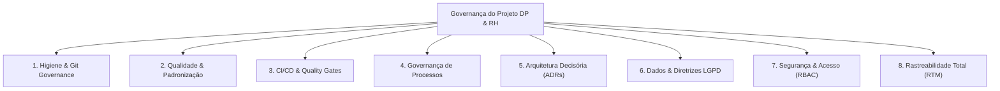

# Manual Integrado de Governança de Tecnologia da Informação (TI) & Software

**Projeto:** Portal DP & RH — Sistema de Departamento Pessoal & Recursos Humanos  
**Autoria:** Equipe Interdisciplinar dos Cursos de Recursos Humanos (RH) e Gestão da Tecnologia da Informação (GTI)  
**Destinatário:** Corpo Docente, Professores Orientadores e Avaliadores Acadêmicos  
**Versão:** 2.1 — Governança e Qualidade Contínua (SPEC-GOV-002)  
**Data:** 28 de Outubro de 2026  

---

## 1. Visão Executiva e Propósito da Governança

A governança corporativa de TI em sistemas de Departamento Pessoal e Recursos Humanos é um elemento crítico de sustentabilidade organizacional. Por manipular dados protegidos pela **Lei Geral de Proteção de Dados (LGPD - Lei nº 13.709/2018)** e realizar apurações financeiras e previdenciárias reguladas pela **Consolidação das Leis do Trabalho (CLT)** e pelo **eSocial**, o sistema opera sob controles formais e verificáveis de desenvolvimento de software.

Este manual consolida a implementação do modelo de **Governança de TI** do projeto, estruturado em **8 Pilares Fundamentais**:



---

## 2. Pilar 1: Higiene e Governança do Repositório Git

Para garantir que o repositório seja auditável, seguro e livre de artefatos indesejados:

1. **Fonte Única da Verdade (Single Source of Truth):**
   - Eliminação canônica de diretórios duplicados (`RH-main/`, `RH-main Camylla/`) e de pacotes compactados residuais (`RH-main.zip`) no commit `92c1549`.
   - Todos os arquivos ativos (backend, frontend, migrações, scripts de banco e suíte de testes) residem canonicamente na raiz do projeto.
2. **Eliminação de Binários e Artefatos Transitórios do Git:**
   - Proibição e expurgo de arquivos compilados de bytecode Python (`__pycache__/*.pyc`).
   - Desvinculação de bancos de dados locais (`colaboradores.db`) do controle de versão. Bancos de desenvolvimento e teste são provisionados sob demanda de forma efêmera e sintética.
3. **Blindagem com `.gitignore` Rigoroso:**
   - Bloqueio de compilações, arquivos `.zip`, logs, coberturas, ambientes virtuais (`.venv`) e arquivos `.env` contendo credenciais.
4. **Gestão Segura de Variáveis de Ambiente:**
   - Disponibilização do modelo `.env.example` sem senhas pré-preenchidas utilizáveis, instruindo a definição obrigatória de `ADMIN_INITIAL_PASSWORD` antes do primeiro uso em ambientes compartilhados.

---

## 3. Pilar 2: Qualidade de Código e Padronização

O código-fonte segue diretrizes universais de formatação e boas práticas da indústria de software:

- **`.editorconfig`:** Garante padronização automática de codificação de caracteres (`UTF-8`), quebras de linha (`LF`) e indentação (4 espaços para Python, 2 espaços para JS, HTML e CSS).
- **`pyproject.toml`:** Centraliza a especificação de dependências, metadados do projeto, regras de linting (`Ruff`), varredura estática de segurança (`Bandit`) e limites de cobertura de testes (`Coverage >= 78%`).
- **`.pre-commit-config.yaml`:** Automação de checagens pré-commit no ambiente local dos desenvolvedores, impedindo commits com espaços em branco excedentes ou arquivos binários pesados.

---

## 4. Pilar 3: Integração Contínua (CI/CD) e Quality Gates Automatizados

A integridade do sistema é fiscalizada por esteiras automatizadas via **GitHub Actions** (com espelhamento de referência em `docs/ci-cd/`):

- **Pipeline Principal (`.github/workflows/ci.yml`):**
  - Disparado em todos os Pushes e Pull Requests para as branches `main` e `develop`.
  - Executa análise estática de conformidade e linting (`ruff check .` — **0 erros**).
  - Executa varredura estática de segurança (`bandit -r backend api -c pyproject.toml` — **0 vulnerabilidades**).
  - Executa integralmente os **64 testes automatizados** da suíte oficial com 100% de aprovação (0 falhas, 0 erros).
  - Mede a cobertura de código (**78% de cobertura de linhas**, superando o limiar de 78%).
- **Pipeline de Auditoria de Vulnerabilidades (`.github/workflows/security.yml`):**
  - Monitoramento de dependências com `pip-audit -r requirements.txt` (**0 vulnerabilidades conhecidas**).

---

## 5. Pilar 4: Governança de Processos e Contribuição

Estabelecimento de regras claras para o ciclo de desenvolvimento:

- **Política de Branches:** Branch `main` protegida, com fluxo estrito via branch temática (`feat/`, `fix/`, `docs/`, `gov/`, `test/`) e abertura de Pull Request.
- **Padrão de Commits:** Adoção do padrão **Conventional Commits** (`feat:`, `fix:`, `docs:`, `refactor:`, `test:`, `chore:`), viabilizando rastreamento semântico de histórico.
- **Definition of Done (DoD):** Nenhuma alteração é integrada sem 100% de sucesso nos testes automatizados, verificação dos quality gates e conformidade com os requisitos oficiais.
- **Modelos Estruturados:**
  - Template de Pull Request (`.github/pull_request_template.md`).
  - Templates de Issue para Defeitos (`01_bug_report.md`), Novas Funcionalidades (`02_feature_request.md`) e Tarefas de Governança (`03_tarefa_governanca.md`).
- **Código de Conduta (`CODE_OF_CONDUCT.md`) & Licença (`LICENSE`):** Diretrizes éticas e licença MIT.

---

## 6. Pilar 5: Governança Arquitetural (Architecture Decision Records - ADRs)

As grandes escolhas técnicas do sistema foram formalmente registradas na pasta `docs/adr/`:

1. **[ADR-001](../adr/ADR-001-arquitetura-dual-mode-banco-de-dados.md):** Arquitetura de Persistência Dual-Mode (SQLite local para testes e PostgreSQL para nuvem).
2. **[ADR-002](../adr/ADR-002-seguranca-autenticacao-e-sessoes.md):** Camada de Segurança, Autenticação PBKDF2-HMAC-SHA256, sessões e proteção de rotas contra acessos anônimos (HTTP 401).
3. **[ADR-003](../adr/ADR-003-unificacao-e-higienizacao-do-repositorio.md):** Unificação Canônica do Código e Higienização do Repositório Git.
4. **[ADR-004](../adr/ADR-004-calculos-da-folha-de-pagamento-e-tabelas-progressivas.md):** Módulo de Folha de Pagamento, Cálculos e Tabelas Progressivas (Status: Proposto / Pendente de Validação de Negócio — DP-08, DP-14, DP-15).
5. **[ADR-005](../adr/ADR-005-pipeline-ci-cd-e-qualidade-continua.md):** Pipeline de CI/CD e Quality Gates Automatizados via GitHub Actions.

---

## 7. Pilar 6: Governança de Dados e Diretrizes LGPD

O projeto cumpre as diretrizes da Lei nº 13.709/2018, detalhadas em [`GOVERNANCA_DADOS_LGPD.md`](GOVERNANCA_DADOS_LGPD.md):

- **Classificação e Minimização:** Coleta exclusiva de informações essenciais para a relação trabalhista e cálculo de folha.
- **Bases Legais Transparentes:** Art. 7º, II (Obrigação Legal) e V (Execução de Contrato).
- **Proteção a Dependentes Menores:** Respeito ao melhor interesse da criança (Art. 14).
- **Inativação Lógica:** Atendimento ao prazo prescricional trabalhista (CLT/FGTS) sem exclusão destrutiva de histórico.
- **Trilha de Auditoria Rastreável:** Registro em banco de dados de todas as alterações cadastrais e lançamentos de folha nas tabelas `historico_alteracoes` e `folha_historico`.
- **Restrição de Acesso Operacional (RF-44 / DP-03):** O portal destina-se exclusivamente a analistas e operadores internos de DP/RH; o exercício de direitos LGPD pelos empregados ocorre via requisição administrativa.

---

## 8. Pilar 7: Segurança da Informação e Controle de Acesso (RBAC)

- Senhas protegidas com 100.000 iterações de **PBKDF2-HMAC-SHA256** e salt criptográfico individual.
- Mitigação de ataques de temporização com `hmac.compare_digest`.
- Tokens de sessão de 32 bytes (64 hex) criptograficamente pseudoaleatórios.
- Perfis de acesso definidos (`analista_rh`, `administrador`).
- Política de segurança formal documentada em [`../../SECURITY.md`](../../SECURITY.md).

---

## 9. Pilar 8: Rastreabilidade Total de Requisitos (RTM)

A Matriz de Rastreabilidade de Requisitos ([`MATRIZ_RASTREABILIDADE.md`](MATRIZ_RASTREABILIDADE.md)) interliga:
- Todos os Requisitos Funcionais oficiais (RF-01 a RF-56 e RF-57 a RF-62);
- Requisitos Não-Funcionais (RNF-01 a RNF-10);
- Regras de Negócio (RN-01 a RN-08);
- Critérios de Aceitação Gerais (CA-01 a CA-09) e Casos de Teste (T-01 a T-12);
- Decisões Pendentes (DP-01 a DP-15) e Indicadores (KPIs 1 a 5);
- Arquivos de código correspondentes no backend e frontend;
- Os **64 testes automatizados** da suíte oficial com 100% de aprovação.

---

## 10. Resumo dos Resultados e Evidências Reais

A suíte consolidada de testes automatizados e os quality gates foram executados e auditados em ambiente local:

```text
================================================================================
 SUÍTE DE TESTES AUTOMATIZADOS — PORTAL DP & RH
 Módulo 1 (Colaboradores), Segurança (Autenticação) & Módulo Folha de Pagamento
 Projeto Interdisciplinar RH & GTI — Departamento Pessoal
 Modo: Execução 100% em código (headless / sem abrir navegador)
================================================================================

Total de Testes Executados: 64
Sucessos: 64 (100%)
Falhas:   0
Erros:    0
Tempo de Execução: ~10.8 segundos
Cobertura de Código: 78% (Limiar: 78%)
Linter (Ruff): 0 erros
Segurança Estática (Bandit): 0 vulnerabilidades identificadas
Auditoria de Dependências (pip-audit): 0 vulnerabilidades conhecidas
Status de Governança: Quality Gates Aprovados
================================================================================
```
